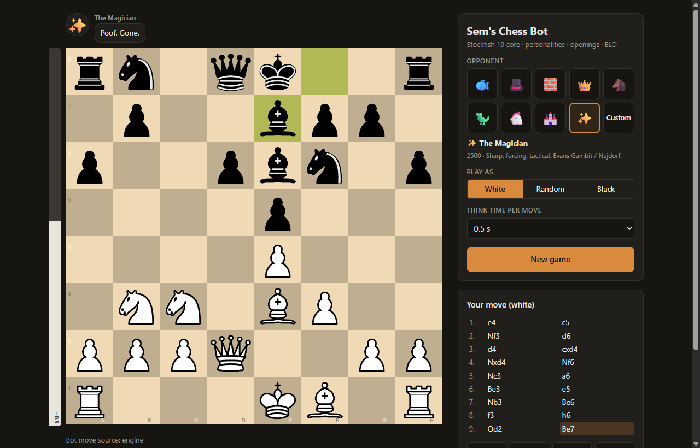
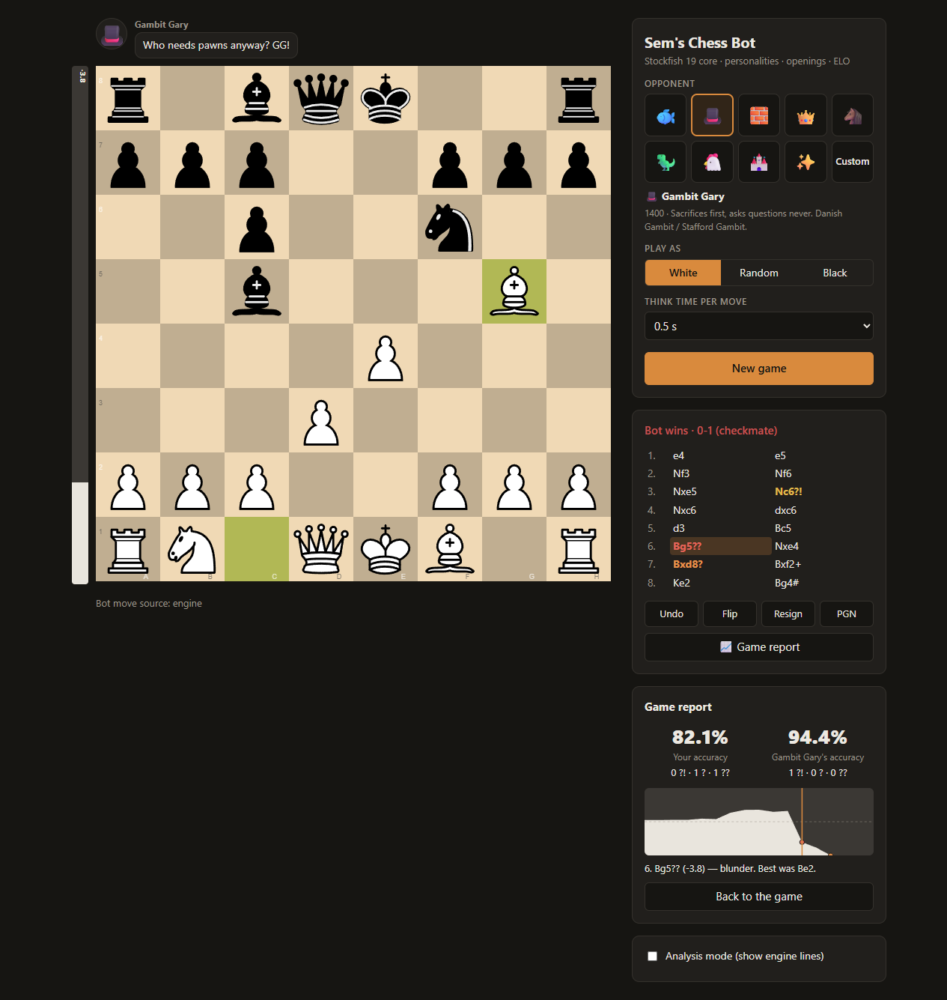

<div align="center">

# ♞ Sem's Chess Bot

**Play Stockfish with a personality.**
A chess bot that runs on your own computer. Pick an opponent, from a pawn-storming dinosaur to a king that
refuses to stay home, then get a full game report afterwards.

[](https://github.com/sem559/sems-chess-bot/actions/workflows/tests.yml)


[](LICENSE)



</div>

## ✨ Features

- 🎭 **9 opponents with personalities.** Each has its own strength, playstyle and favourite openings, and they talk during the game.
- 🤪 **Joke playstyles** like Bongcloud (always 1.e4, 2.Ke2), Pawn Storm, Knight Rider, Coward and Never Castles. Stockfish is still underneath, so they're harder to beat than they look.
- 🎚️ **Any strength from 400 ELO to full Stockfish 19.** From 1320 up this uses Stockfish's own calibrated ELO limiter.
- 📖 **32 opening repertoires.** The bot follows its line (Najdorf, King's Gambit, London, Stafford…) until you leave it.
- 📈 **Game report.** Accuracy for both sides, ?! / ? / ?? marks, an evaluation graph, and "best was…" for every move.
- 🔍 **Analysis mode.** See Stockfish's top 3 lines while you play.
- 🤖 **Optional Lichess bot.** Run your own openly labelled BOT account that accepts challenges.
- 🏠 **Runs locally.** No accounts, no servers, no tracking: everything runs on your machine.

## 🚀 Quick start

You need **Python 3.11+** and **git**.

```bash
git clone https://github.com/sem559/sems-chess-bot.git
cd sems-chess-bot
python -m venv .venv
```

Activate the virtual environment:

| Windows (PowerShell) | macOS / Linux |
|---|---|
| `.venv\Scripts\Activate.ps1` | `source .venv/bin/activate` |

Then install, fetch the engine, and play:

```bash
pip install -e .
python scripts/get_stockfish.py   # downloads the official Stockfish 19 for your OS (~80 MB)
sems-chess                        # opens the game in your browser
```

That's it. The game opens at **http://127.0.0.1:8000**, which is only reachable from your own computer.

> Already have Stockfish installed (`brew install stockfish`, `apt install stockfish`, …)? Then skip
> `get_stockfish.py`: the bot finds `stockfish` on your PATH. You can also point `STOCKFISH_PATH` in
> `.env` at any UCI engine binary.

## 🎭 Meet the opponents

| | Opponent | ELO | Style | Openings (White / Black) | Typical line |
|:-:|---|:-:|---|---|---|
| 🐟 | **Fish Prime** | max | balanced | none | *"Hello. I have evaluated your chances."* |
| 🎩 | **Gambit Gary** | 1400 | gambit | Danish / Stafford | *"Pawns are a currency, and I'm a big spender!"* |
| 🧱 | **The Wall** | 2200 | solid | London / Caro-Kann | *"I hope you brought a chisel."* |
| 👑 | **Bongcloud Bob** | 1200 | bongcloud | 1.e4 & 2.Ke2, always | *"Castling is for cowards. Let's walk."* |
| 🐴 | **Knightmare** | 1600 | knight rider | Four Knights / Alekhine | *"Bishops are just knights that can't jump."* |
| 🦖 | **Pawnzilla** | 1800 | pawn storm | King's Gambit / Dutch | *"RAWR. Pawns, march!"* |
| 🐔 | **Coward Carl** | 1500 | coward | Scotch / Petrov | *"Can we just trade everything and go home?"* |
| 🏰 | **Never-Castle Nelly** | 1700 | never castles | Vienna Gambit / Scandinavian | *"Castling is a scam invented by rooks."* |
| ✨ | **The Magician** | 2500 | tactical | Evans Gambit / Najdorf | *"Pick a card. Any card."* |

Prefer to tune things yourself? Pick **Custom** to set the ELO, style (10 to choose from) and opening by hand.

### Make your own opponent

Add an entry to [`sems/data/personalities.json`](sems/data/personalities.json) and restart. It then shows up in the picker:

```json
{
  "id": "grandpa_joe", "name": "Grandpa Joe", "avatar": "👴",
  "tagline": "1300 · Has played the London System since 1974.",
  "elo": 1300, "style": "solid", "openings": {"white": "london", "black": "slav"},
  "lines": {
    "greeting": ["Back in my day we played with wooden pieces."],
    "blunder": ["Ha! Saw that one coming."],
    "win": ["Still got it. Good game, kiddo."],
    "loss": ["Well played. Same time next week?"],
    "draw": ["A fair result."]
  }
}
```

- **Styles:** `balanced`, `aggressive`, `solid`, `tactical`, `gambit`, `bongcloud`, `pawn_storm`, `knight_rider`, `coward`, `never_castles`
- **Openings:** any `id` from [`sems/data/openings.json`](sems/data/openings.json). The `white` opening is used when the bot plays White, and `black` when it plays Black.
- **Chat events:** `greeting`, `check`, `capture`, `blunder` (when you just gave something away), `winning`, `losing`, `win`, `loss`, `draw`

You can add your own opening lines to `openings.json` the same way. The test suite checks that every line is legal.

## 📈 Game report

When a game ends, click **📈 Game report**. Every position is checked by Stockfish, and you get the accuracy for both
sides, mistakes marked ?! / ? / ??, and an evaluation graph. Click the graph or a move, or use ← →, to replay the
game and see what you should have played.

<div align="center">

<br><sub>Falling for Gambit Gary's Stafford trap: 6.Bg5?? Nxe4! 7.Bxd8? Bxf2+ 8.Ke2 Bg4#</sub>
</div>

Accuracy and the mistake thresholds use [Lichess's published formulas](https://lichess.org/page/accuracy).

## 🤖 Run your own bot on Lichess (optional)

Your bot can play on Lichess as an **openly labelled BOT account** through the official Bot API.
It only plays games that people challenge it to.

1. Create a **new** Lichess account for the bot. Upgrading to a BOT is permanent, and the account must have no games played.
2. Create a token at <https://lichess.org/account/oauth/token> with the **`bot:play`** scope.
3. Copy `.env.example` to `.env` and set `LICHESS_TOKEN=...`
4. Upgrade the account (one time, irreversible):
   ```bash
   curl -d '' https://lichess.org/api/bot/account/upgrade -H "Authorization: Bearer YOUR_TOKEN"
   ```
5. Do a dry run (a simulated game, no network), then go live:
   ```bash
   sems-lichess --dry-run
   sems-lichess
   ```

[`sems/lichess/config.yaml`](sems/lichess/config.yaml) sets:
- which challenges the bot accepts (time controls, rated/casual, humans/bots, how many games at once)
- who plays each time control, e.g. `blitz: {personality: gambit_gary}`

A personality also says hello and GG in the game chat. Stockfish gets the real clocks, so it manages its own time.

> ⚠️ Never use this, or any engine, to get help in your own games on Lichess, chess.com or elsewhere. That's cheating,
> and it gets accounts banned. The BOT runner refuses to run on an account that isn't a BOT account.

## 💪 How strong is it?

At full strength, the bot **is** Stockfish 19, one of the strongest chess engines in the world. The personalities
and styles deliberately give up a little strength to play in character. Want numbers? Play two configurations
against each other:

```bash
python scripts/match.py --a elo=1500 --b elo=2000 --games 100      # does the ELO slider scale?
python scripts/match.py --a style=aggressive --b max --games 400    # what does a style cost?
python scripts/match.py --a style=tactical --b max --sprt 0 5       # SPRT: is it at least +5 Elo?
```

<details>
<summary><b>How a move is chosen</b></summary>

`SemsBot.choose_move` in [`sems/bot.py`](sems/bot.py):

1. **Repertoire:** play the next move of the chosen opening while the game is still on that line.
2. **Signature moves:** e.g. Bongcloud Bob's 1.e4 and 2.Ke2 (never into a mate in one).
3. **Polyglot book:** optional `.bin` books dropped in `books/`.
4. **Stockfish:** either Stockfish picks the move itself (balanced style, or with its built-in ELO limiter), or it
   returns its top moves.
5. **Style and strength:** only moves within a centipawn window of the best are allowed. Style bonuses tilt
   the choice (checks for Aggressive, trades for Coward, …), and lower ELOs sample with more randomness.
   A forced mate is never given up.

**Thinking time:**
- With a fixed think time, a full-strength bot spends 25% of it on a quick search. If one move is clearly
  best (a recapture, a free piece), it plays that move straight away.
- On Lichess, Stockfish's own time manager decides.

</details>

<details>
<summary><b>Project layout</b></summary>

```
sems/
  bot.py            move pipeline (repertoire → style → book → Stockfish → style/strength)
  engine.py         Stockfish (UCI) wrapper
  strength.py       ELO → engine settings
  styles.py         playstyles
  openings.py       repertoires + Polyglot books
  personalities.py  opponents + chat
  report.py         post-game report maths
  data/             openings.json, personalities.json
  web/              FastAPI server + browser UI (chessground board)
  lichess/          Lichess BOT runner + config.yaml
scripts/
  get_stockfish.py  downloads the official engine for your OS
  match.py          strength testing (Elo + SPRT)
tests/              pytest suite (runs on Windows, macOS and Linux in CI)
```

</details>

## 🛠️ Development

```bash
pip install -e ".[dev]"
python -m pytest            # needs Stockfish; engine tests skip without it
```

Ideas and pull requests are welcome, especially new personalities and opening lines.

## 🙏 Credits & license

Built on the shoulders of:
- [Stockfish](https://stockfishchess.org/), the engine
- [chessground](https://github.com/lichess-org/chessground), the board from Lichess
- [python-chess](https://github.com/niklasf/python-chess)
- [berserk](https://github.com/lichess-org/berserk)
- [FastAPI](https://fastapi.tiangolo.com/)

Released under the [GNU GPL v3.0](LICENSE), the same license as Stockfish and chessground.
Stockfish is downloaded separately from its [official releases](https://github.com/official-stockfish/Stockfish/releases)
and isn't included in this repository.
